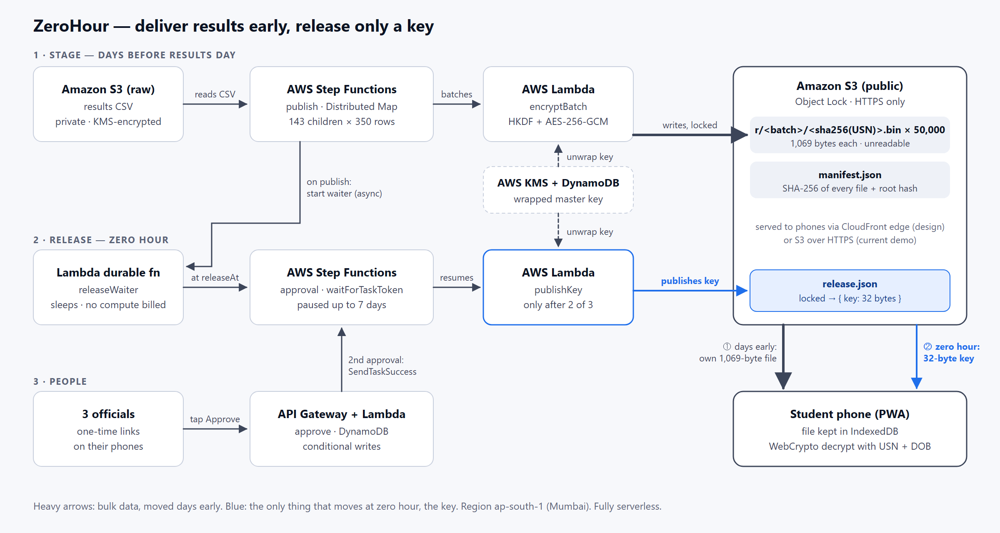

# ZeroHour

**Exam results that can't crash on results day.**

Every year results websites go down the moment results are announced. ZeroHour borrows how game launches work: every student's result is encrypted and pushed to the CDN *days early*, and at zero hour the only thing anyone downloads is a **32-byte key**. Decryption happens on the student's phone.

> All data in this repo is synthetic. IDs look like `DEMO23CS00001` and names like `Demo Student 00001`.

**Demo video (2:08):** https://youtu.be/50Qq4v5fQLI

**Live demo (S3 direct over HTTPS):**
- Student app: https://zerohour-publicbucket-u1yrxzfhm0pv.s3.ap-south-1.amazonaws.com/index.html
- Control room: https://zerohour-publicbucket-u1yrxzfhm0pv.s3.ap-south-1.amazonaws.com/dashboard.html

CloudFront is built into the template (`EnableCdn=true`) but is waiting on AWS account verification. Until then the app is served straight from S3 over HTTPS. Only the public bucket is readable, and everything in it is the app, ciphertext or `release.json`. See [docs/COSTS.md](docs/COSTS.md).

## Status

| Milestone | What | State |
|---|---|---|
| M1 | Crypto module, synthetic data, local encrypt → decrypt round trip | ✅ done |
| M2 | SAM stack: S3, CloudFront, Step Functions Distributed Map publish | ✅ deployed; 50,000 results staged in 37 s. CloudFront waits on AWS account verification ([notes](docs/M2-NOTES.md)) |
| M3 | Student PWA: pre-fetch + WebCrypto decrypt | ✅ tested in the browser: locked → auto-decrypt in under 3 s, works offline ([notes](docs/M3-NOTES.md)) |
| M4 | 2-of-3 approval flow + publishKey | ✅ proven on AWS: 1 approval stays locked, 2nd releases the key in 3.5 s ([notes](docs/M4-NOTES.md)) |
| M5 | Durable-function release waiter | ✅ proven on AWS (Mumbai): slept 5 min at no compute cost, opened approvals 2.9 s after releaseAt by itself ([notes](docs/M5-NOTES.md)) |
| M6 | Dashboard, load test, cost counter | ✅ dashboard + cost counter live against AWS; load test ready, waiting on CloudFront ([notes](docs/M6-NOTES.md)) |
| M7 | Builder Center write-up, architecture diagram, demo video | ✅ [write-up](docs/WRITEUP.md), [diagram](docs/architecture.png), [screenshots](docs/screenshots/), [video script](docs/VIDEO-SCRIPT.md); video still to record |



## Try M1 locally

Requires Node.js 22 or later.

```bash
npm install
npm test                    # 58 unit tests
npm run gen                 # 50,000 synthetic students → data/results.csv
npm run stage               # encrypt all → out/public/r/*.bin + manifest + release.json (locked)
npm run verify              # proves nothing can be opened before release
npm run release:local       # publishes the key in release.json
npm run verify -- --sample 500   # 500 random students decrypt with WebCrypto
```

Measured on a Windows laptop (10 Nov 2026): staging 50,000 results took 9.1 s, of which encryption was 3.4 s. Decryption took about 0.5 ms per student.

## Try the student app (M3)

```bash
npm run stage -- --release-at 2026-11-16T04:30:00Z
npm run web:build && npm run web:serve     # open http://localhost:5173
# enter DEMO23CS00001 / 22-05-2005 → saved & locked
npm run release:local                      # the page decrypts by itself within ~3 s
```

## Deploy to AWS (M2)

Needs the AWS CLI v2, the SAM CLI, and credentials for `ap-south-1`. See [docs/M2-NOTES.md](docs/M2-NOTES.md).

```bash
npm run deploy -- --guided        # first time; later just: npm run deploy
npm run publish:batch -- --batch demo-2026-11 --release-at 2026-11-16T04:30:00Z
npm run destroy                   # after judging: empties buckets (bypassing Object Lock) and deletes the stack
```

```
CSV ─► S3 raw (KMS) ─► Step Functions ─► CreateBatch (KMS data key → DynamoDB, release.json locked)
                              │
                              ├─► Distributed Map, 350 rows per child ─► encryptBatch ─► S3 public r/<sha256>.bin (Object Lock)
                              │
                              └─► FinalizeManifest ─► manifest.json (row count checked) ─► CloudFront (OAC)
```

## How the crypto works

- One random 256-bit **master key** per results batch. In M1 it is generated locally; from M2 it comes from KMS `GenerateDataKey` and only its encrypted form is stored.
- Each student's key is derived with **HKDF-SHA256**, using the master key, a random 16-byte salt per file, and `zerohour/v1|<batchId>|<USN>|<DOB>`.
- Each result is encrypted with **AES-256-GCM**. The file header is authenticated too, so any change to the header is caught.
- Every result is padded to the same size, so every file is exactly **1,069 bytes**: `version | salt | iv | ciphertext | tag`. File size can't reveal anything about the result.
- Files are named `sha256(USN).bin`, so no USN appears in a URL.
- `manifest.json` stores the SHA-256 of every file plus a root hash, so any changed file can be detected.

**Before release**, no one can read any result, AWS included, because the key isn't public anywhere. **After release**, a result opens with USN + date of birth, which is the same rule today's results portals use.

## Layout

```
src/crypto/format.ts        byte layout, normalisation, HKDF info (browser-safe)
src/crypto/node-encrypt.ts  encrypt with node:crypto (Lambda side)
src/crypto/web-decrypt.ts   decrypt with WebCrypto (browser side)
src/crypto/filename.ts      sha256(USN) file names
src/crypto/manifest.ts      integrity manifest + root hash
src/data/                   synthetic generator, grading, CSV
src/lambda/publish.ts       createBatch / encryptBatch / finalizeManifest (pure, tested with fakes)
src/lambda/aws.ts           KMS, DynamoDB, S3 adapters
src/lambda/entry/           Lambda handlers
statemachine/               Step Functions definition (Distributed Map)
template.yaml               SAM stack
scripts/                    local gen/stage/verify + deploy/publish/destroy
docs/                       M1 plan, M2 notes
```
