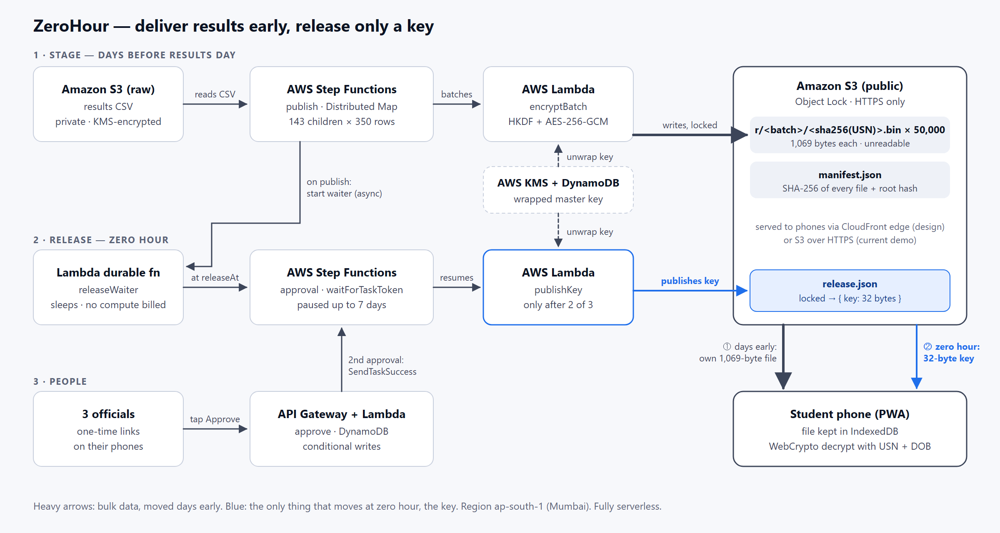

# ZeroHour: exam results that can't crash on results day

**Ship every result days early, encrypted. At zero hour, release only a 32-byte key.**

## The problem

In India, results websites go down at the exact moment results are announced, year after year. Students refresh a spinning page while the one server everyone needs falls over.

- Karnataka's KCET results site went down right after results were announced on 6 June 2026 ([Careers360](https://engineering.careers360.com/articles/kcet-2026-result-website-crashed)).
- Madhya Pradesh Board result sites crashed within minutes under more than 16 lakh students ([Free Press Journal](https://www.freepressjournal.in/indore/mpbse-results-2026-websites-crash-lakhs-of-students-left-waiting-as-anxiety-peaks)).

The traffic shape explains it. Hundreds of thousands of people want *their own* small file in the *same minute*, and every one of those requests hits the origin at once.

## The idea

Game launchers solved this years ago. You pre-load the encrypted game days before launch, and at launch time you only download a tiny unlock key.

ZeroHour does the same for exam results:

1. **Days before:** each student's result is encrypted with its own key and published as a 1,069-byte file. Students open the app once, and their phone saves *their* encrypted file.
2. **At zero hour:** two of three exam officials approve on their phones. Then only one thing changes: `release.json` gains a 32-byte key.
3. **On every phone:** the app sees the key and decrypts the result locally (WebCrypto) using the student's USN and date of birth. That takes about 3 ms.

Before release, **nobody can read any result**: not the university website, not us, not AWS. The key doesn't exist anywhere public.

## What I built (all serverless, ap-south-1 Mumbai)

| Service | What it does in ZeroHour |
|---|---|
| **Amazon S3** | A private, KMS-encrypted bucket for the uploaded results CSV. A second bucket for the 50,000 encrypted files with **S3 Object Lock** (GOVERNANCE), so published marks can't be quietly swapped. It also holds `manifest.json` (SHA-256 of every file) and `release.json`. |
| **AWS Step Functions** | **Distributed Map** reads the CSV straight from S3 and fans out to 143 parallel batches of 350 rows. A second workflow uses a **waitForTaskToken callback** to pause, for free, until officials approve. |
| **AWS Lambda** | `encryptBatch` (HKDF-SHA256 per student + AES-256-GCM), `finalizeManifest`, `openApprovals`, the approval API, `publishKey`, and the dashboard's metrics API. |
| **Lambda durable functions** | `releaseWaiter` **sleeps until release time with no compute billed**, then opens approvals. The publish workflow starts it automatically. |
| **Amazon DynamoDB** | Batch records (with the KMS-wrapped master key) and approval state, using conditional writes so two simultaneous taps release only once. |
| **AWS KMS** | Generates each batch's master key. Only its encrypted form is ever stored, tied to the batch through the encryption context. |
| **Amazon API Gateway (HTTP API)** | One-time approval links for officials, plus public `/status` and `/metrics` endpoints for the live dashboard. Throttled. |
| **Amazon CloudWatch** | Traffic and error graphs on the control-room dashboard, which also shows a live cost estimate. |
| **Amazon CloudFront** | Designed in, with OAC, a 1-year cache for result files and at most 5 s for `release.json`. It's one flag (`EnableCdn`) and waiting on new-account verification; the demo serves the same files straight from S3 over HTTPS. |

The whole stack is a single **AWS SAM** template. There are no servers, containers or pipelines.

## How the pieces connect

1. **The exam office uploads a CSV.** `npm run publish:batch` uploads it and starts the publish workflow.
2. **Batch setup:** `createBatch` asks KMS for a data key and stores only the encrypted copy in DynamoDB. `release.json` is written as `{released:false}`.
3. **Encryption:** the Distributed Map gives each Lambda 350 rows. Each one validates its rows, derives a per-student key, encrypts, and writes `r/<batch>/<sha256(USN)>.bin` with Object Lock. No USN ever appears in a URL, and each batch has its own path, so a cached file from last semester can never be served for this one.
4. **Manifest:** `finalizeManifest` merges the partial manifests, checks there is **exactly one file per CSV row**, and publishes `manifest.json` with a root hash.
5. **Schedule:** the last publish step starts the **durable `releaseWaiter`**. It reads `releaseAt` in a checkpointed step, then `wait`s, suspended, until then.
6. **Zero hour:** the waiter starts the approval workflow. `openApprovals` stores the task token, and the workflow pauses. Approvals are refused before `releaseAt`.
7. **Officials approve:** each official opens a one-time link (the database stores only the SHA-256 of the token) and taps **Approve**. The approval that reaches 2 of 3 flips `OPEN → APPROVED` with a DynamoDB condition, and calls **`SendTaskSuccess`**.
8. **Key published:** `publishKey` unwraps the master key with KMS and writes `release.json {released:true, key}`. With CloudFront on, it also invalidates the cached copy.
9. **Phones open results:** every waiting phone checks `release.json` every 2–3 s (with jitter), finds the key, and decrypts.

## It runs: measured on AWS

| What | Measured |
|---|---|
| Encrypt + stage 50,000 results | **37 s** end to end (143 parallel batches) |
| Durable waiter: scheduled wake-up vs actual | woke **0.35 s** after its scheduled time; approvals open **2.9 s** after release time, untouched |
| 2nd official taps Approve → key public | **1.6 s** |
| Decrypt on the phone | **≈ 3–4 ms** |
| Integrity | 25/25 sampled files match the manifest and decrypt to exactly their source rows |
| Tests | 151 automated tests: the crypto round trip (Node encrypt ↔ browser WebCrypto decrypt, plus a fixed test vector), approval rules (1 approval stays locked, 2 releases, duplicates ignored, expired links rejected, simultaneous taps release once), the durable waiter (official local test runner), and template guards |

## What it costs

These are list-price estimates from the AWS Price List for Mumbai and India, shown live on the dashboard:

- **Staging 50,000 encrypted results:** ≈ **$0.26**, almost all of it S3 PUTs.
- **Results day for 50,000 students** each checking 100 times (5.05M requests): **$0** inside CloudFront's always-free tier, or ≈ $2.11 served straight from S3.
- **Idle:** ≈ **$1/month**, which is the KMS key.

## Security, and what it doesn't claim

- **Before release, nothing can be read.** Every file is AES-256-GCM encrypted, and the key isn't public anywhere.
- **After release, a result opens with USN + date of birth.** That's the same rule today's portals use, so someone who knows a student's USN could try birth dates. ZeroHour's gain is *before* release, plus the fact that the results site can't fall over.
- **Every file is exactly 1,069 bytes,** so file size reveals nothing (such as a long list of backlogs).
- **2 of 3 officials must approve,** and release can't happen early. Both are enforced in several layers and tested.
- **Object Lock and the manifest's root hash** make quiet edits after publishing detectable.

## Reuse the pattern

The idea is **"publish early, encrypted; release a key on approval"**. It fits anything that millions open at a fixed moment: admit cards, recruitment results, tender openings, embargoed announcements, lottery draws. The stack is one SAM template, `npm run deploy`, `publish:batch`, `approvers:invite`, then wait.

## What I learned

- **Lambda durable functions are a perfect "sleep until a date" primitive.** One `context.wait` replaced a scheduler, a polling loop and a state table, and it costs nothing while asleep. They work in Mumbai. Put anything non-deterministic (like `Date.now()`) inside a `step`, because code outside steps runs again on every replay.
- **New accounts can run only 10 Lambdas at once.** My first 50,000-row run with `MaxConcurrency: 20` was throttled and stopped at 83 of 143 batches. Capping at 8 and giving throttling its own retry fixed it. The publish step was built to be re-run safely, and resuming the same batch was proven for real.
- **A Distributed Map child gets at most 256 KiB of input.** 500 CSV rows as JSON don't fit, so I measured and settled on 350.
- **S3 Object Lock uploads must carry a checksum.** I added `ChecksumAlgorithm: SHA256`.
- **WebCrypto and service workers only work on secure (HTTPS) pages.** That forced the S3-HTTPS demo path while CloudFront waits for account verification.
- **SAM's in-source build runs an `npm update` that strips dev dependencies.** Bundling with esbuild myself kept builds fast and predictable.
- **Rehearse the demo.** A dry run caught a real bug: result files were cached "forever" under `sha256(USN)`, so the same student in a new batch got last batch's cached file. Results are now stored per batch (`r/<batch>/…`), and the app re-downloads when a new batch goes live. A regression test now guards it.

## Try it

- **Student app:** https://zerohour-publicbucket-u1yrxzfhm0pv.s3.ap-south-1.amazonaws.com/index.html (synthetic data; IDs look like `DEMO23CS00001`)
- **Control room:** https://zerohour-publicbucket-u1yrxzfhm0pv.s3.ap-south-1.amazonaws.com/dashboard.html
- **Demo video:** _add YouTube link_
- **Code:** https://github.com/mohammed-tousif/zerohour

*All data in ZeroHour is synthetic. No real student information is used.*
